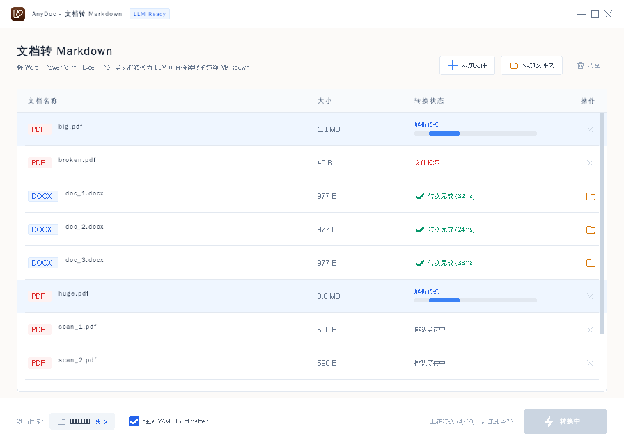

# AnyDoc for Windows

> 把 Word / PowerPoint / Excel / PDF / EPUB 等文档转成干净的 Markdown
>
> **解析内核：[firecrawl/anydoc](https://github.com/firecrawl/anydoc) v0.2.4（MIT）**
>
> **原生 Windows 窗口** —— 无浏览器、无 WebView2、零运行时依赖。



一个用官方 anydoc 内核做的 Windows 桌面工具 —— 拖文件进去，出来 Markdown。

---

## 为什么有这个项目

[firecrawl/anydoc](https://github.com/firecrawl/anydoc) 是目前最干净的文档转换引擎：

- 纯 Rust，无 Python/Node 依赖，无外部服务
- 14 种格式统一输出 GFM Markdown
- **按文件字节签名识别格式**，改过扩展名的文件照样解析对
- 官方 benchmark 中位 4.4ms

但它官方只提供 CLI 和各语言 binding，没有 Windows GUI。本项目补上这一块。

---

## 下载

Releases 页只有一个包：

| 文件 | 大小 | 说明 |
|------|------|------|
| [`AnyDoc-v0.5.7-win-x64-portable.zip`](https://github.com/Kelisiqiang/anydoc-gui/releases/download/v0.5.7/AnyDoc-v0.5.7-win-x64-portable.zip) | 3.7MB | **免安装版**：解压即用，不需要装任何运行时 |

> 解压后目录结构要保留（`resources/` 里是图标资源）。
> 已用 SHA256 自签名 + DigiCert 时间戳签名。

---

## 使用

1. 解压整个文件夹
2. 双击 `AnyDoc.exe`
3. 拖入文档（或点「添加文件 / 添加文件夹」）→ 确认输出目录 → 点「开始转换」

**转换进度直接显示在软件窗口里**，不用切到浏览器。

> 全部转换在本地完成，文件不上传任何服务器。

### 界面上能干什么

| 操作 | 结果 |
|------|------|
| 拖文件 / 拖文件夹到窗口 | 加入队列（文件夹会递归，子目录结构保留） |
| 点「开始转换」 | 后台线程池批量转换，**每个文件独立进度** |
| 点行尾的 📂 | **直接打开该文件所在文件夹**（资源管理器定位到生成的 .md） |
| 点行尾的 ✕ | 从队列里移除这一条（转换中也能移除，会中止该任务） |
| 点「更改」 | 换输出目录（默认与源文件同目录） |
| ☑ 注入 YAML Frontmatter | 给每个 .md 加 front matter，方便 LLM 读取 |

### 命令行（可选）

同一个 exe 也带 CLI 模式：

```cmd
AnyDoc.exe report.docx              :: 单文件
AnyDoc.exe .\docs\ -o .\md\         :: 指定输出目录
```

---

## 支持格式（14 种）

| 类别 | 扩展名 |
|------|--------|
| Word | `.doc` `.docx` `.docm` |
| PowerPoint | `.ppt` `.pptx` `.pptm` |
| Excel | `.xls` `.xlsx` `.xlsm` `.xlsb` |
| OpenDocument | `.odt` `.ods` `.odp` |
| 其他 | `.rtf` `.epub` `.csv` `.pdf` |

### 格式识别看字节，不只看后缀

anydoc 读取文件签名（PDF header、RTF open group、OLE stream name、ZIP 内部 mimetype）判断真实类型。

把 `report.docx` 改名成 `report.pdf`，**它依然能正确解析** —— 这在处理用户上传的乱标文件时很关键。

---

## 已知边界

| 情况 | 行为 |
|------|------|
| 扫描件 / 图片版 PDF | ❌ 不支持，需要 OCR —— 官方 anydoc 内核本地就不含 OCR；**本版完全本地运行，不联网、不上传文档**（界面提示「需 OCR」） |
| 加密文档 | ❌ 报错 `文件已加密` |
| 结构损坏文件 | ❌ 报错 `文件结构损坏`（不会返回半成品） |
| 超出安全限制 | ❌ 报错 `超出安全限制` |
| Excel 公式 | 读取计算结果，不保留公式 |

界面报错时会显示具体原因，不是笼统的「转换失败」。

---

## 更新日志

| 版本 | 改动 |
|------|------|
| **v0.5.7** | **修使用过程闪烁**：v0.5.4 加的「防黑屏兜底」有个副作用 —— 每次重绘都先把整个窗口刷成背景色再贴内容，等于每帧闪一下（转换时进度条动画最明显）。改成只在「位图建不出来」的兜底路径才刷窗口；同时离屏位图改成**复用**（原来每帧新建/销毁一张几 MB 的位图，分配抖动也会看成卡顿） |
| **v0.5.6** | **回到纯本地版：不含任何云端功能**，程序运行期间不联网、不上传文档（v0.5.5 那版的云端 OCR 已撤下，能力保留在源码的 `ocr` 编译开关里，需要时一句话就能开回来） |
| **v0.5.5** | ⚠️ **这一版带云端 OCR**（会把扫描件发到 Firecrawl 解析）。介意隐私、或不需要的话请改用 **v0.5.6** |
| **v0.5.4** | **修最大化黑屏**：客户区计算改成用 `WINDOWPOS` 的窗口矩形（不再混用屏幕/窗口两套坐标），最大化时客户区 = 工作区 ∩ 窗口矩形；位图建不出来时不再往窗口里塞 NULL（那会导致整个界面画不出来 = 黑屏），改为直接往窗口 DC 绘制；客户区异常时先夹紧再画；新增 `anydoc-diag.log` 诊断日志与崩溃自动记录 |
| **v0.5.3** | **修复窗口无法最大化 / 关闭按钮点不动**：滚动条的点击热区没限制 y 坐标，把标题栏的「最大化 / 关闭」按钮一起吞了；最大化后客户区没重算；最大化位置改成相对显示器（多显示器不再飞出屏幕） |
| **v0.5.2** | 修复最大化后右侧窗口按钮被切掉；重画云上传图标；**修正字体字号**（实际渲染比设计稿小一圈）；还原图标重画 |
| **v0.5.1** | 修复点行尾 📂 被误判成删除（行会被删掉而不是打开文件夹）；打开失败自动兜底打开父目录 |
| **v0.5.0** | 界面按设计稿精确还原：无边框窗口（消掉顶部空白带）、表格改 `grid-cols-12 gap-4` 栅格、行内进度条与阶段文字连成一体、删掉底部多余的总进度条、头部按钮按内容排版并补上垃圾桶图标、输出目录框重排 |
| v0.4.4 | 解决 Windows SmartScreen 弹窗（包内附 `首次运行.bat`） |
| v0.3.0 | 改成原生 Windows 窗口，移除安装包与网页版 |

---

## 排障

### 窗口最大化后一片黑

旧版本（v0.5.2 / v0.5.3）在部分电脑上最大化会整屏黑屏。
**v0.5.4 已修**：客户区计算不再混用坐标系，位图失败会退化成直接绘制，不会再出现「什么都没画」的黑屏。

如果你的机器上还是黑屏，请把下面两个信息发过来，一起定位：

1. 程序目录（或 `%TEMP%`）下的 **`anydoc-diag.log`** —— 里面记着缩放比例、窗口/客户区矩形、工作区，每次启动和窗口变化都会写
2. 你的**屏幕分辨率 + Windows 缩放比例**（设置 → 系统 → 显示），以及**是否接了多显示器**

> `anydoc-diag.log` 只是纯文本诊断信息，不含任何文档内容，可以放心发。

---

## 从源码编译

```bash
# 需要 Rust 1.88+（anydoc 0.2.4 要求 edition 2024）
git clone <this-repo>
cd native

# 交叉编译 Windows
rustup target add x86_64-pc-windows-gnu
export CC_x86_64_pc_windows_gnu=x86_64-w64-mingw32-gcc
cargo build --release --target x86_64-pc-windows-gnu
```

核心逻辑测试：

```bash
cd core-test && cargo test
```

---

## 致谢

**解析内核 anydoc** —— Copyright Firecrawl, Inc.，MIT License
https://github.com/firecrawl/anydoc

本项目仅提供 Windows GUI 封装与分发，解析能力全部来自 anydoc。

---

## 许可

MIT
